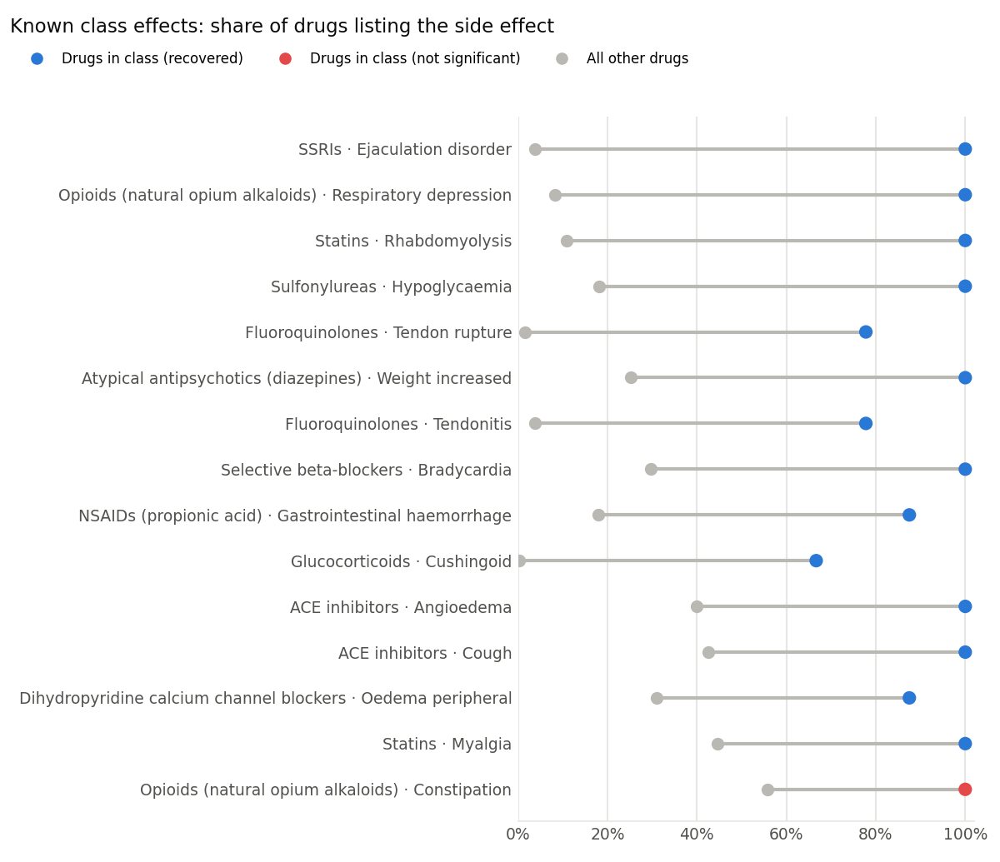
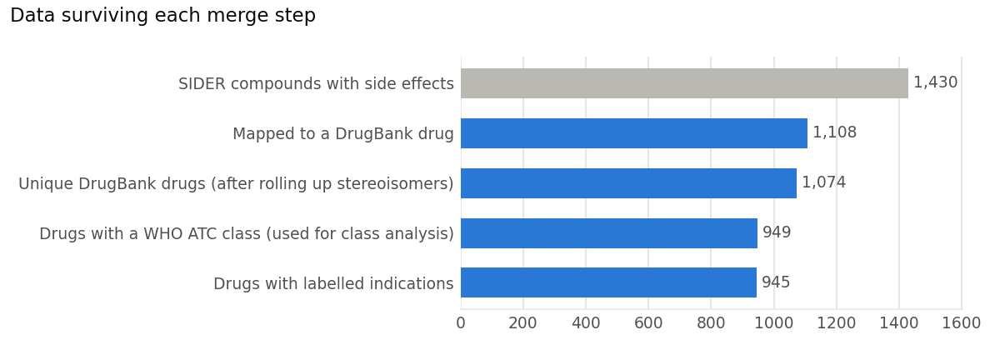

# Drug Side-Effect Signals: Which Side Effects Belong to a Drug Class?

**Question:** When a side effect shows up on a drug's label, is it specific to that kind of drug, or does it appear on almost every label?
This project links three public datasets (drug labels, a drug encyclopedia, and the WHO drug-class system) and tests every
*drug class × side effect* pair. The output is a ranked list of side effects that are statistically over-represented in each class.

**Stack:** Python (pandas, SciPy) · SQL (DuckDB) · star-schema data model · Tableau / Power BI · interactive web dashboard



## Key findings

| | |
|---|---|
| Drugs analysed | **1,074** (949 with a WHO drug class) |
| Labelled drug–side-effect pairs | **121,247** across **4,048** distinct side effects |
| Class × side-effect pairs tested | **42,665** across 302 classes |
| Statistically over-represented (FDR q < 0.05, odds ratio ≥ 2) | **13,667** |
| Textbook class effects recovered | **14 of 15** that had enough drugs to test |

1. **The method finds known pharmacology without being told.** Statins → rhabdomyolysis (odds ratio 139), fluoroquinolones → tendon rupture (192), SSRIs → ejaculation disorder (282), ACE inhibitors → cough and angioedema, and sulfonylureas → hypoglycaemia all come out as strong signals.
2. **It also surfaces less obvious class effects.** These include immune-mediated necrotising myopathy for statins, osteonecrosis of the jaw for bisphosphonates, coronary vasospasm for triptans, lactic acidosis for nucleoside reverse-transcriptase inhibitors, and pemphigus for ACE inhibitors.
3. **Very common side effects cannot be class-specific.** Opioid constipation is the one known effect the method missed. Every opioid lists it, but so do 56% of all drugs, so the contrast is too weak. Nausea (86% of labels) and headache (81%) behave the same way.
4. **Side-effect profiles carry pharmacological meaning.** A drug's most similar drug by side-effect profile shares its chemical subgroup **29.9%** of the time, versus **0.6%** for two random drugs.
5. **Trials miss rare serious events.** For 56% of the labels listing rhabdomyolysis, and about half of those listing Stevens-Johnson syndrome, toxic epidermal necrolysis or torsade de pointes, the effect is listed only from post-marketing reports.
6. **Placebo arms matter.** Hypersensitivity, migraine and atrial fibrillation are reported about as often on placebo as on the active drug, so a label mention is not evidence the drug causes them.

## Data

| Source | What it gives | Size |
|---|---|---|
| [SIDER 4.1](http://sideeffects.embl.de/) (via [dhimmel/SIDER4](https://github.com/dhimmel/SIDER4)) | Side effects, frequencies and indications text-mined from FDA drug labels, coded to MedDRA | 309,849 side-effect rows, 291,632 frequency rows |
| [DrugBank](https://go.drugbank.com/) extract (via [dhimmel/drugbank](https://github.com/dhimmel/drugbank)) | Drug names, approval status, ATC codes, PubChem mappings | 7,759 drugs |
| [WHO ATC classification](https://atcddd.fhi.no/) (via [fabkury/atcd](https://github.com/fabkury/atcd)) | 5-level drug-class hierarchy, 2026 and 2021 releases | 7,536 codes |

SIDER data is licensed CC BY-NC-SA 4.0, so this project is non-commercial.

## The hard part: merging datasets with no shared key



The three sources do not share an identifier, and several data problems had to be solved before any analysis could run:

| Problem | What I did |
|---|---|
| SIDER uses STITCH IDs (`CID100047725`), DrugBank uses `DB00014` | Decoded STITCH into PubChem compound IDs (both the stereo-free "flat" ID and the stereo-specific ID), then joined through three mapping sources in priority order: exact InChI match → curated crosswalk → UniChem connectivity. 77.5% of compounds mapped. |
| One compound matched several DrugBank entries (salts, mixtures) | Ranked candidates by mapping source, then whether the drug has an ATC class, then approval status, and kept exactly one (`QUALIFY ROW_NUMBER()`). |
| Racemates and single enantiomers mapped to the same drug | Rolled facts up to the DrugBank drug, so a drug is never counted twice. |
| Every label term appears twice (low-level term and preferred term) | Kept MedDRA preferred terms only, which avoids double-counting synonyms like "abdominal cramps" and "abdominal pain". |
| Frequency words like "common" mean 1–100% | Midpoints of those bands produced fake 50.5% rates. I used only precise frequencies (a range of 5 points or less). |
| DrugBank's ATC codes are from ~2016; WHO restructured classes since (e.g. cancer drugs in 2022) | Resolved each code against the 2026 release, fell back to 2021, and flagged retired codes. 1,351 of 1,394 drug–class links are current. |
| A drug can belong to several classes | Modelled this as a bridge table rather than a column. |
| "Indications" include any condition mentioned anywhere on the label | Used only `NLP_indication` rows. `text_mention` includes warnings, and `NLP_precondition` is closer to a contraindication. |

Six data-quality assertions run on every build and fail loudly. They check for one drug per compound, no duplicate facts, referential integrity, and valid proportions.

## Data model

```
dim_drug ─┬─ bridge_drug_atc ── dim_atc_class         (many-to-many drug classes)
          ├─ fact_drug_side_effect ── dim_side_effect  (freq_drug, freq_placebo, excess_over_placebo)
          └─ fact_drug_indication  ── dim_condition
```

## Method: disproportionality analysis

For each class C (WHO ATC levels 2–4, at least 4 drugs) and each side effect S listed on at least 3 drugs in C, I built a 2×2 table:

|  | has S | no S |
|---|---|---|
| drug in C | a | b |
| drug not in C | c | d |

- **One-sided Fisher's exact test** (computed with the hypergeometric distribution, vectorised over all 42,665 pairs) gives a p-value.
- **Benjamini–Hochberg** correction controls the false discovery rate across all the tests.
- **Odds ratio** with a Haldane–Anscombe correction, plus a 95% confidence interval.
- A pair is a **signal** when q < 0.05 and the odds ratio is at least 2.
- **Validation:** I listed 18 textbook class effects in advance and checked whether the method recovers them.

This is the same idea pharmacovigilance teams use on adverse-event reports (the reporting odds ratio), applied to drug labels.

## Limitations

- **Label co-occurrence is not causation.** Drugs in one class often share label templates, which inflates within-class similarity.
- **Label length is a confounder.** Drugs with 300+ listed side effects average 22.8 serious ones, versus 1.9 for drugs with fewer than 50. Newer, heavily trialled drugs have longer labels.
- **Snapshot data.** SIDER 4.1 was released in 2015, so it misses newer drugs and label updates.
- **Coverage.** 322 of 1,430 SIDER compounds (22.5%) could not be mapped to DrugBank.
- **The serious-event list is author-curated** (inspired by the EMA Important Medical Event list), not an official standard.

## Run it

```bash
pip install -r requirements.txt
bash scripts/00_download.sh      # ~14 MB of public data into data/raw/
python src/run_pipeline.py       # builds the database, runs the analysis, writes all outputs (~10 s)
```

## Repository layout

```
scripts/00_download.sh        fetch raw data
sql/01_staging.sql            typed staging tables
sql/02_crosswalk.sql          SIDER → PubChem → DrugBank key mapping
sql/03_model.sql              star schema
sql/04_analysis_queries.sql   nine business questions in SQL (window functions, CTEs, QUALIFY)
src/build_database.py         runs the SQL + data-quality checks
src/analysis.py               Fisher tests, FDR, validation, Jaccard similarity
src/export.py                 Tableau/Power BI CSVs + dashboard data
src/figures.py                README charts
outputs/bi_exports/           every table and view as CSV, ready for Tableau / Power BI
outputs/key_numbers.json      headline numbers quoted above
```
